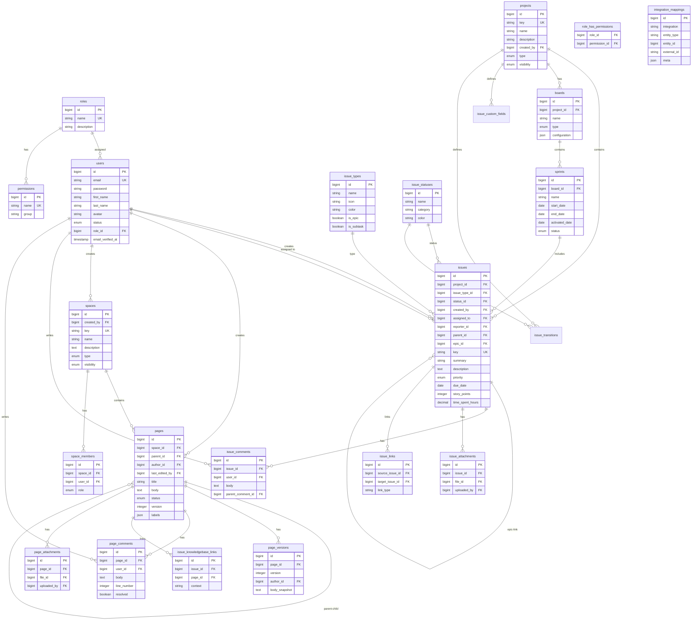

# ER-диаграмма базы данных

## 1. Диаграмма (Mermaid)



## 2. Описание таблиц

### Основные сущности

#### `users`
Пользователи системы. Поле `role_id` определяет роль (1 = admin).

#### `roles`
Роли: admin, user, и кастомные.

#### `projects`
Проекты tasksbase. Содержат задачи, доски, спринты.

#### `issues`
Задачи проекта. Поддерживают:
- Иерархию (parent-child)
- Epic linking
- Комментарии
- Вложения
- Связи (linked issues)
- Work tracking (time tracking)

#### `boards`
Канбан/Scrum доски.

#### `sprints`
Спринты для Scrum.

#### `spaces`
Пространства Knowledgebase.

#### `pages`
Страницы Knowledgebase с версионированием.

#### `integration_mappings`
Маппинг локальных сущностей на внешние идентификаторы (интеграция с 1С):
- `integration` — идентификатор интеграции (`one_c`);
- `entity_type` — `user`, `issue`, `project`, `page` и т.п.;
- `entity_id` — локальный id; `external_id` — идентификатор в 1С;
- `meta` — дополнительная служебная информация (JSON);
- unique `(integration, entity_type, external_id)`, индекс `(integration, entity_type, entity_id)`.

### Связи и ограничения

- **Issues:** `assigned_to`, `created_by`, `parent_id`, `epic_id` — nullable FK
- **Pages:** `parent_id` — self-referencing для иерархии
- **Comments:** `parent_comment_id` — вложенные комментарии
- **Issue Links:** unique constraint на (source, target, type)
- **Space Members:** unique constraint на (space_id, user_id)

### Индексы

```sql
-- Issues
(project_id, status_id)
(project_id, issue_type_id)
(assigned_to)
(epic_id)
(parent_id)

-- Pages
(space_id, status)
(parent_id)

-- Integration mappings
(integration, entity_type, entity_id)
UNIQUE (integration, entity_type, external_id)
```
